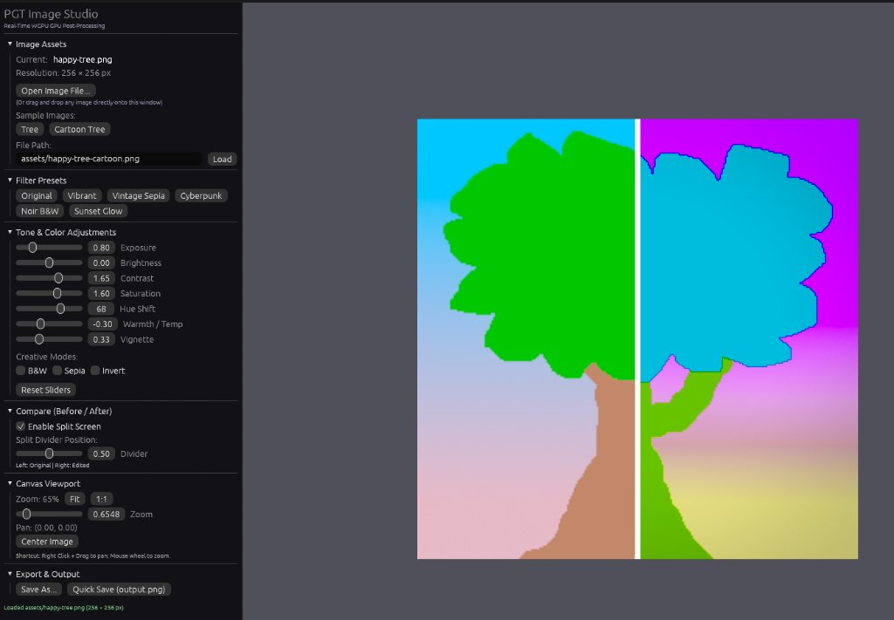

# 🚀 Learn GPU — Rust & WGPU Graphics Programming

A hands-on repository exploring modern GPU programming in **Rust** using **`wgpu`** and **`winit`**, based on [**Learn Wgpu**](https://sotrh.github.io/learn-wgpu/) with modern adaptations:
- **Math**: [`glam`](https://crates.io/crates/glam) instead of `cgmath`.
- **3D Models**: [`gltf`](https://crates.io/crates/gltf) instead of `tobj`.
- **Chapters 1–12**: Use the shared **`framework`** crate for window lifecycle and device setup.
- **Demos**: Use the **`pgt`** crate (an extension of `framework`) providing high-level abstractions, pipeline builders, and native **`egui`** UI support.

---

## 📦 Workspace Architecture

- **`framework/`**: Powers Chapters 1–12. Handles `winit` 0.30 `ApplicationHandler` lifecycle, device/surface configuration, and keyboard/mouse hooks.
- **`pgt/` (Programmable GPU Toolkit)**: An extension of `framework` for rapid prototyping. Modular building blocks rather than a rigid framework: fluent `PipelineBuilder`, `UniformBinding`, camera controllers, and first-class `egui` integration (root `&mut Ui`).
- **`chapters/`**: Tutorial crates (1–12) powered by `framework`.
- **`demos/`**: Advanced showcase applications (`demos/demo-pgt`, `demos/ImageEditor`) powered by `pgt`.

---

## 🎮 Chapters & Demos

| Chapter / Demo | Description | Abstraction |
| :--- | :--- | :--- |
| **Tutorial 1: Window** | Window creation & event loop | `framework` |
| **Tutorial 2: Triangle** | First draw pass, pipeline, and WGSL shaders | `framework` |
| **Tutorial 3: Buffers** | Vertex and index buffers | `framework` |
| **Tutorial 4: Textures** | Texture loading, sampling, and bind groups | `framework` |
| **Tutorial 5: Uniforms** | 3D Camera, uniform buffers, projection | `framework` |
| **Tutorial 6: Instance** | Hardware instancing for rendering multiple meshes | `framework` |
| **Tutorial 7: Particles** | Dynamic instanced particle rendering | `framework` |
| **Tutorial 8: Model** | 3D GLTF model loading and multi-material meshes | `framework` |
| **Tutorial 9: Light** | Blinn-Phong lighting with orbiting point light | `framework` |
| **Tutorial 10: Normals** | Tangent-space normal mapping and TBN matrix | `framework` |
| **Tutorial 11: Better Camera** | First-person camera controller with mouse look | `framework` |
| **Tutorial 12: HDR & Skybox** | HDR cubemap compute, tonemapping & skybox | `framework` |
| **Demo: PGT** | Interactive 3D model viewer with egui controls | `pgt` |
| **Demo: Image Editor** | Real-time GPU post-processing, split-screen, file I/O | `pgt` |

---

## 🎨 Demo: Image Editor (`demos/ImageEditor`)



A lightweight GPU post-processing editor demonstrating how **`egui`** integrates with our custom abstractions in **`pgt`** (an extension of `framework`).

- **Real-Time GPU Filters**: Exposure, contrast, saturation, hue shift, warmth, and vignette.
- **Split-Screen Compare**: Interactive before/after split slider.
- **Pan & Zoom Canvas**: Aspect-preserving pan and zoom controls.
- **Native File Dialog**: Load images via OS file picker (`rfd`) or drag-and-drop.

```bash
cargo run -p ImageEditor
```

---

## 🚀 Quick Start

Run any chapter or demo with Cargo:

```bash
# Run tutorials (using framework crate)
cargo run -p tutorial2-triangle
cargo run -p tutorial8-model
cargo run -p tutorial12-hdr

# Run demos (using pgt crate + egui)
cargo run -p demo-pgt
cargo run -p ImageEditor
```

### Controls (3D Scenes)
- **`W`/`A`/`S`/`D`** or **Arrows**: Move camera
- **`Space` / `Shift`**: Fly up / down
- **Right Click + Drag**: Orbit / Look around
- **Mouse Wheel**: Zoom
- **`Esc`**: Exit

---

## 🛠 Tech Stack

- **Language**: Rust (Edition 2024)
- **Graphics API**: `wgpu` (30.0)
- **Math Library**: `glam` (0.34)
- **Windowing**: `winit` (0.30)
- **UI**: `egui` (0.37)
- **Asset Loading**: `gltf` (1.4), `image` (0.25)
- **Tutorial Reference**: [Learn Wgpu by sotrh](https://sotrh.github.io/learn-wgpu/)
